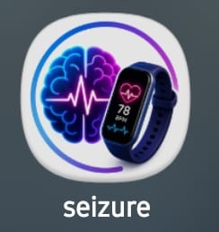
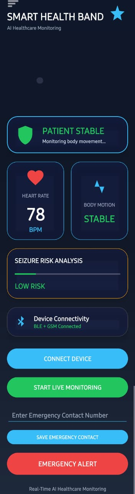
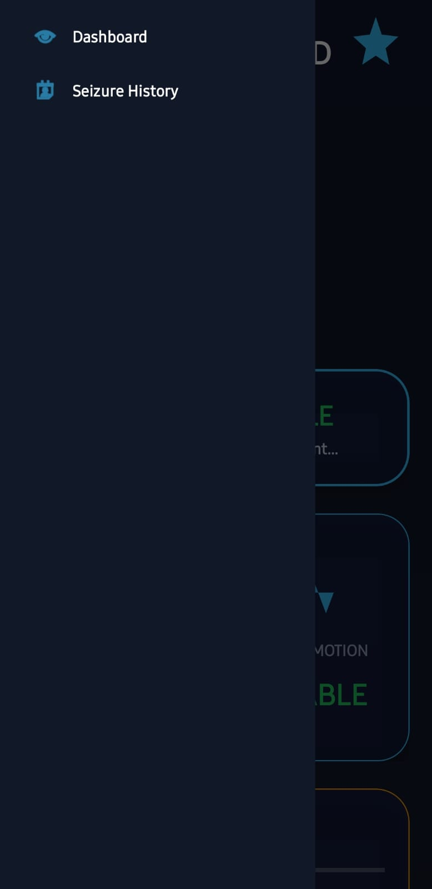
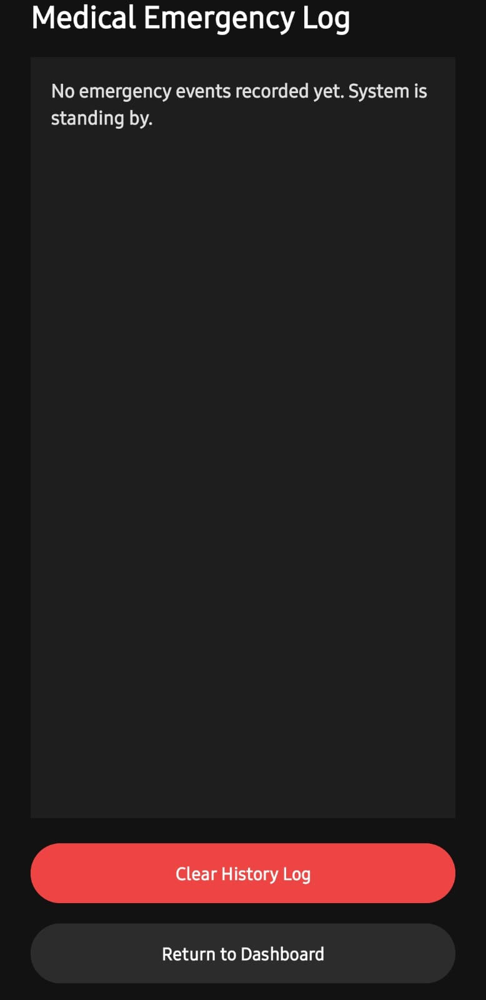

#  Wearable Seizure Detection & Safety Device


🏆 **Winner:** Project Competition at the Zynex Event (Cambridge Institute of Technology)

An integrated IoT safety prototype engineered to detect physical anomalies associated with seizures and automate emergency response. The system utilizes an ESP32 microcontroller running MicroPython to process live sensor data, paired with a custom Android dashboard for real-time monitoring and alert management.

---

## 📸 Application Interface

| Main Dashboard | Application Menu | Emergency Log |
| :---: | :---: | :---: |
|  |  |  |

---

## ✨ System Architecture

### 1. Hardware Module (ESP32)
* **Firmware:** MicroPython (`.py`)
* **Core Sensors:** MPU6050 (Accelerometer/Gyroscope) for detecting sudden falls or erratic movements, and pulse sensors for heart rate anomalies.
* **Processing:** Continuously samples sensor data and triggers hardware interrupts when thresholds are breached.

### 2. Companion Android Application
* **Framework:** Java / Android Studio
* **Functionality:** Pairs with the wearable device to display real-time sensor metrics and user status.
* **Emergency Protocol:** Acts as the communication bridge to dispatch alerts if a critical physical event is detected by the ESP32.

---

## 📂 Repository Structure

```text
├── app/                    # Android Studio application source code
├── assets/                 # UI screenshots and icons
├── esp32_firmware/         # Hardware code directory containing main.py
├── build.gradle.kts        # Android build configuration
└── readme.md               # Project documentation